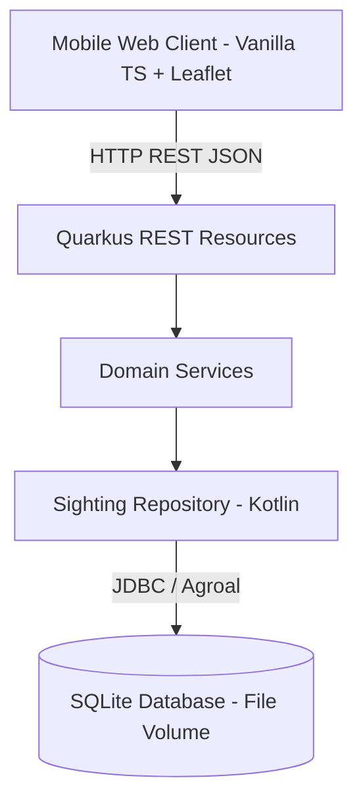
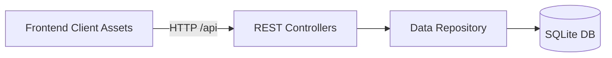
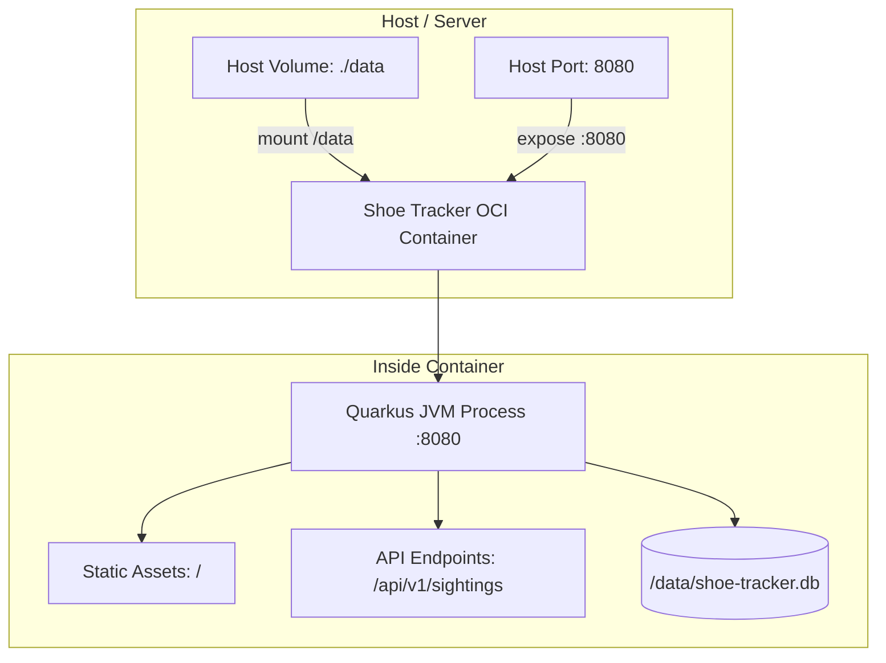

# Architecture Spine - Shoe Tracker

## Design Paradigm

Layered Two-Tier Modular architecture hosted in a unified OCI container:
- **Presentation Layer (Frontend):** Modern Vanilla TypeScript SPA bundled with Vite, interacting with browser Geolocation API and Leaflet.js map renderer.
- **API & Domain Layer (Quarkus Backend):** Quarkus REST endpoints exposing JSON contracts, routing requests to domain services in Kotlin.
- **Persistence Layer (Data Access):** Kotlin DAO / Repository executing parameterized SQL queries over SQLite via Agroal connection pooling.



## Invariants & Rules



### AD-1 - Direct SQLite JDBC Persistence with Flyway [ADOPTED]

- **Binds:** `R1`, `R6`, `C3`
- **Prevents:** Database driver friction, schema drift, unsupported dialect anomalies between Quarkus ORM and SQLite, and SQLITE_BUSY write lock contention.
- **Rule:** Persistence must use `org.xerial:sqlite-jdbc` with Quarkus Agroal connection pooling. Schema migrations must be managed via Flyway SQL scripts located in `src/main/resources/db/migration/` containing pure DDL without transaction-unsafe PRAGMA statements. Database writes must be serialized via an in-process lock in the repository to prevent write concurrency lock errors while keeping read queries fully parallel and unlocked. Hibernate/JPA ORM dialects for SQLite are forbidden.

### AD-2 - Single-Container Packaging with Vite Frontend Bundling [ADOPTED]

- **Binds:** `C1`, `C4`, `C5`
- **Prevents:** Desynchronized frontend/backend deployments, CORS configuration complexity, and multi-container hosting overhead.
- **Rule:** The web UI must be implemented in TypeScript/HTML5 with Vite and built into `src/main/resources/META-INF/resources/`. Quarkus must serve these static assets at the root path (`/`). A multi-stage Dockerfile must compile frontend assets in Node, compile the Quarkus JAR with Gradle, and output a single runnable container image.

### AD-3 - Gradle Build Tool and JVM Runtime Mode [ADOPTED]

- **Binds:** `C2`
- **Prevents:** Build script maintenance fragmentation across Kotlin projects, and JNI library loading failures associated with SQLite native C-bindings under GraalVM native images.
- **Rule:** The backend must use Gradle with Kotlin DSL (`build.gradle.kts`) targeting Java 25 in Quarkus JVM mode. GraalVM native image compilation is prohibited for SQLite compatibility.

### AD-4 - Versioned REST API with Nested Location and Wrapped Collection [ADOPTED]

- **Binds:** `R1`, `R4`, `R5`, `R6`
- **Prevents:** Breaking API changes when future geographic or user profile attributes are added, unversioned breaking transitions, and unbounded collection payload memory exhaustion on mobile networks.
- **Rule:** The REST API must be versioned in the URI path under `/api/v1/sightings`. Creation requests (`POST /api/v1/sightings`) must accept a flat `user_id` string alongside a nested `location` object (`latitude`, `longitude`) and ISO-8601 UTC timestamp `recorded_at`. Query responses (`GET /api/v1/sightings` and POST 201 response) must embed user identity in a `user: { id }` object to insulate future profile extensions without polluting root records. Entity IDs must be generated as time-sortable UUIDv7 strings. Collection queries must return an envelope object `{ "items": [...], "total": ..., "limit": ..., "offset": ... }` and support optional `limit`, `offset`, and `user_id` parameters.

### AD-5 - SQLite Storage Schema and Pragma Configuration [ADOPTED]

- **Binds:** `R1`, `R2`, `R6`, `C3`
- **Prevents:** SQLite database write lock timeouts during rapid requests, data loss on container restart, and Flyway transactional DDL errors.
- **Rule:** Database file must reside at `/data/shoe-tracker.db` mapped to an external volume in production. SQLite connections must configure `journal_mode = WAL` and `busy_timeout = 5000` via DataSource connection URL and init-SQL outside Flyway migrations. The `sightings` table schema must strictly store `(id, user_id, latitude, longitude, recorded_at, created_at)`. For the MVP, `user_id` stores the user's entered name directly as both identity and display name. Dedicated logins, profiles, and changeable usernames are deferred to the backlog. Bearing is excluded until prioritized. Timestamps are stored in UTC and rendered in local client time.

### AD-6 - Client Geolocation Watcher, Cooldown and Identity Scoping [ADOPTED]

- **Binds:** `R1`, `R2`, `R4`, `R5`, `R7`, `C5`
- **Prevents:** GPS satellite acquisition lag during high-speed travel, accidental duplicate tap submissions, and losing track of user's own sightings.
- **Rule:** The client app must prompt for the user's name on first launch and retain it in `localStorage` as `user_id`. The browser must maintain an active background `navigator.geolocation.watchPosition` loop with `enableHighAccuracy: true` so the latest fix is held hot in memory. Tapping the record button must immediately submit the hot coordinates and engage a 3-5 second client-side cooldown lock. Map markers and list items matching the local `user_id` must render with the user's distinct own-shoes styling, and the interface must provide a toggle to hide records with non-matching `user_id`.

## Consistency Conventions

| Concern | Convention |
| --- | --- |
| Naming | Endpoints use kebab-case with version prefix (`/api/v1/sightings`); wire JSON fields use snake_case (`user_id`, `recorded_at`, `created_at`); DB columns use snake_case; Kotlin classes use PascalCase. |
| Data & formats | Identifiers: UUIDv7 string. Coordinates: WGS84 decimal degrees (REAL). Timestamps: ISO-8601 UTC string (`YYYY-MM-DDTHH:mm:ss.sssZ`). Collections: `{ "items": [...], "total": ..., "limit": ..., "offset": ... }`. |
| State & cross-cutting | Client identity: Local storage (`user_id` stores the user's entered name for MVP). Database concurrency: SQLite WAL mode with 5000ms busy timeout. |
| Error responses | RFC 7807 problem details JSON: `{ "type": "about:blank", "title": "...", "status": 400, "detail": "..." }`. |

## Stack

| Name | Version |
| --- | --- |
| Java | 25 |
| Kotlin | 2.1.10 |
| Quarkus | 3.40.1.1 |
| sqlite-jdbc | 3.53.4.0 |
| Flyway | 10.21.0 |
| Vite | 6.2.0 |
| TypeScript | 5.7.3 |
| Leaflet | 1.9.4 |

## Structural Seed

```text
shoe-tracker/
  Dockerfile                            # Multi-stage build (Vite -> Gradle -> JRE)
  build.gradle.kts                      # Quarkus Kotlin build configuration
  settings.gradle.kts
  src/
    main/
      kotlin/org/shoetracker/
        api/
          SightingResource.kt           # Quarkus REST endpoints
          dto/                          # Request and response DTOs
        domain/
          Sighting.kt                   # Domain entity models
          SightingService.kt            # Core business logic & validations
        repository/
          SightingRepository.kt         # Direct JDBC SQL data access
      resources/
        application.properties          # Quarkus & Agroal configuration
        db/migration/
          V1__init_sightings.sql        # Initial SQLite DDL
        META-INF/resources/             # Output directory for Vite UI bundle
  frontend/
    package.json                        # Frontend dependencies (Leaflet, Vite)
    vite.config.ts                      # Configured to build into META-INF/resources
    index.html
    src/
      main.ts                           # App entry point & view switcher
      geo.ts                            # Background watchPosition manager
      api.ts                            # REST client for backend API
      map.ts                            # Leaflet map setup and marker management
      list.ts                           # Historical list view component
      style.css                         # Mobile-first CSS styling
```

### Deployment Topology



## Capability -> Architecture Map

| Capability / Area | Lives in | Governed by |
| --- | --- | --- |
| One-Tap Capture (`R1`) | `frontend/src/main.ts`, `frontend/src/geo.ts` | AD-4, AD-6 |
| User Onboarding & Name (`R2`) | `frontend/src/main.ts`, `localStorage` | AD-5, AD-6 |
| List View (`R4`) | `frontend/src/list.ts` | AD-4, AD-6 |
| Map View & Markers (`R5`) | `frontend/src/map.ts`, Leaflet | AD-4, AD-6 |
| Lean REST API (`R6`) | `org.shoetracker.api.SightingResource` | AD-1, AD-4 |
| Tap Cooldown (`R7`) | `frontend/src/main.ts` | AD-6 |
| Two-Tier Architecture (`C1`) | Frontend SPA / Quarkus Backend | AD-2 |
| Kotlin & Quarkus (`C2`) | `src/main/kotlin/`, `build.gradle.kts` | AD-3 |
| SQLite Persistence (`C3`) | `SightingRepository.kt`, `V1__init_sightings.sql` | AD-1, AD-5 |
| Single Container Packaging (`C4`) | `Dockerfile` | AD-2, AD-5 |
| Mobile-First UI (`C5`) | `frontend/src/style.css` | AD-2, AD-6 |

## Deferred

- **Compass Heading / Bearing:** Omitted until hardware orientation sensor integration and data contracts are prioritized.
- **Dedicated Authentication, Profiles & Changeable Usernames (Architecture Comment):** For MVP, `user_id` stores the entered name directly on the wire and in SQLite; the frontend maps this to "Enter your name". `POST` accepts a flat `user_id` while `GET` embeds `user: { id }`. When implementing this backlog item, expand the embedded `user` object with profile attributes (`display_name`, `avatar`, etc.) without altering root sighting schemas, and introduce `/api/v1/users` if dedicated profile management is needed. Tracked in `backlog/story-dedicated-user-profiles-and-login.md`.
- **Offline Queuing / ServiceWorker Sync:** Direct online HTTP submission is enforced for MVP; IndexedDB offline queueing deferred.
- **Real-Time Map Streaming via Server-Sent Events (SSE):** Live push of new sightings to connected clients using in-process Quarkus CDI events and SSE deferred to backlog (`backlog/story-realtime-map-updates-via-sse.md`). MVP uses standard REST retrieval.
- **Batch Upload API for Offline Synchronization:** A batch endpoint (`POST /api/v1/sightings/batch`) deferred to backlog to be implemented alongside offline queueing.
- **Geospatial Viewport / Bounding-Box Query:** Bounding-box filtering (`bbox=minLon,minLat,maxLon,maxLat`) on `GET /api/v1/sightings` deferred to backlog until sighting density requires client viewport culling.
- **Shoe Metadata Classification (Extensibility Hint):** Sighting types, brands, and color tags deferred to backlog. Architectural hint: When implemented, model as an extensible nested `attributes` JSON container to avoid root schema pollution.
- **Map Marker Clustering:** Basic Leaflet markers used for MVP; clustering library (e.g. Leaflet.markercluster) deferred until sighting density requires it.
