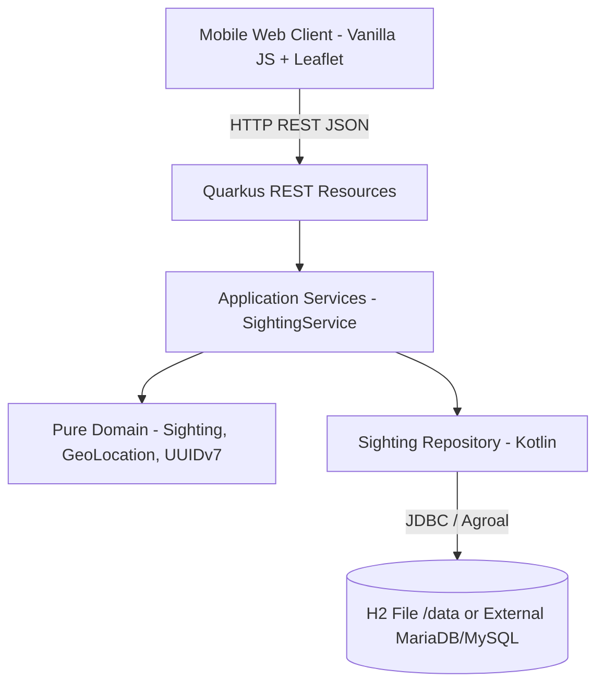
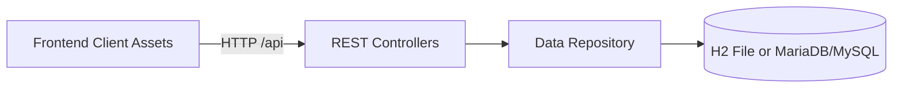
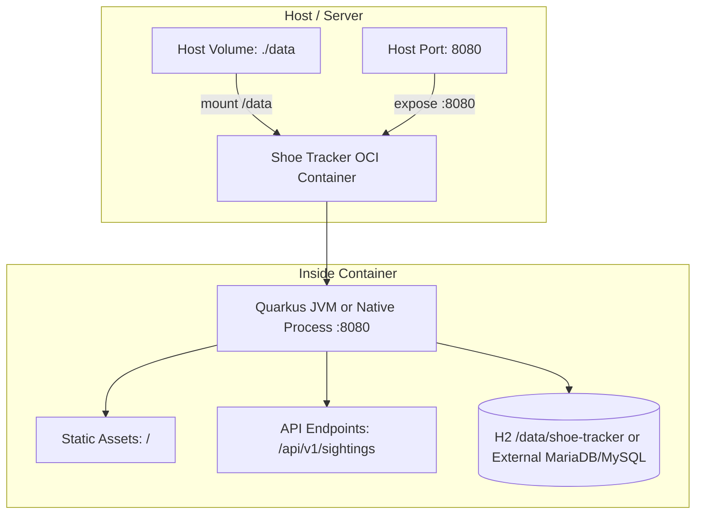

# Architecture Spine - Shoe Tracker

## Design Paradigm

Layered Two-Tier Modular architecture hosted in a unified OCI container:
- **Presentation Layer (Frontend):** Modern Vanilla ES6+ SPA interacting with browser Geolocation API and Leaflet.js map renderer, served directly from `src/main/resources/META-INF/resources/` per Quarkus static web resource conventions.
- **API Layer (REST Resources):** Quarkus REST endpoints in `org.shoetracker.api` exposing JSON contracts and RFC 7807 problem details.
- **Application Services Layer:** `org.shoetracker.service.SightingService` orchestrating business workflows, input validation, and mapping between DTOs and domain entities.
- **Pure Domain Core:** `org.shoetracker.domain` containing pure domain entities (`Sighting`), value objects (`GeoLocation`), and domain utilities (`UUIDv7`) with zero outward dependencies on repository or DTO layers.
- **Persistence Layer (Data Access):** `org.shoetracker.repository.SightingRepository` executing parameterized SQL queries over H2 (`MODE=MySQL`) or MariaDB/MySQL via Agroal connection pooling.



## Invariants & Rules



### AD-1 - Direct SQLite JDBC Persistence with Flyway [SUPERSEDED by AD-9]

- **Binds:** `R1`, `R6`
- **Prevents:** Database driver friction, schema drift, unsupported dialect anomalies between Quarkus ORM and SQLite, and SQLITE_BUSY write lock contention (Epics 1-5; superseded by AD-9 in Epic 6).
- **Rule:** Superseded in Epic 6 by AD-9 (`io.quarkus:quarkus-jdbc-h2` and `io.quarkus:quarkus-jdbc-mariadb` with Flyway ANSI/MySQL DDL and lock-free Agroal connection checkouts).

### AD-2 - Single-Container Packaging with Quarkus Classpath Web Resources [ADOPTED]

- **Binds:** `C1`, `C4`, `C5`
- **Prevents:** Desynchronized frontend/backend deployments, CORS configuration complexity, and multi-container hosting overhead.
- **Rule:** The web UI is implemented in vanilla HTML5, CSS, and modern JavaScript located in `src/main/resources/META-INF/resources/`. Per Jakarta/Servlet 3.0+ and Quarkus specifications, resources in `META-INF/resources/` are automatically served directly at the root HTTP path (`/`) without requiring build copy tasks, proxying, or Node.js runtime overhead, while supporting instantaneous hot-reload in Quarkus dev mode. A multi-stage Dockerfile compiles the Quarkus fast-jar with Gradle on JDK 25 and outputs a minimal runnable JRE 25 container image.

### AD-3 - Gradle Build Tool and JVM / GraalVM Native Runtime Modes [ADOPTED]

- **Binds:** `C2`, `R27`
- **Prevents:** Build script maintenance fragmentation across Kotlin projects, and slow container startup times in serverless or auto-scaled environments.
- **Rule:** The backend must use Gradle with Kotlin DSL (`build.gradle.kts`) targeting Java 25 in Quarkus JVM mode by default, and supports standalone GraalVM native image compilation via in-container Mandrel tooling (`-Dquarkus.native.container-build=true`) with `src/main/docker/Dockerfile.native` for sub-50ms cold starts. All REST DTOs serialized via generic `Response.entity(...)` (such as `ProblemDetails`) must be annotated with `@RegisterForReflection`.

### AD-4 - Versioned REST API with Nested Location and Wrapped Collection [ADOPTED]

- **Binds:** `R1`, `R4`, `R5`, `R6`, `R9`
- **Prevents:** Breaking API changes when future geographic or user profile attributes are added, unversioned breaking transitions, and unbounded collection payload memory exhaustion on mobile networks.
- **Rule:** The REST API must be versioned in the URI path under `/api/v1/sightings`. Creation requests (`POST /api/v1/sightings`) must accept a flat `user_id` string alongside a nested `location` object (`latitude`, `longitude`) and ISO-8601 UTC timestamp `recorded_at`. Query responses (`GET /api/v1/sightings` and POST 201 response) must embed user identity in a `user: { id }` object to insulate future profile extensions without polluting root records. Entity IDs must be generated as time-sortable UUIDv7 strings. Collection queries must return an envelope object `{ "items": [...], "total": ..., "limit": ..., "offset": ... }` and support optional `limit`, `offset`, and `user_id` parameters. Deletion requests (`DELETE /api/v1/sightings/:id`) remove an existing sighting by ID for immediate client-side confirmation undo.

### AD-5 - SQLite Storage Schema and Pragma Configuration [SUPERSEDED by AD-9]

- **Binds:** `R1`, `R2`, `R6`
- **Prevents:** SQLite database write lock timeouts during rapid requests, data loss on container restart, and Flyway transactional DDL errors (Epics 1-5; superseded by AD-9 in Epic 6).
- **Rule:** Superseded in Epic 6 by AD-9. The `sightings` table schema continues to store `(id, user_id, latitude, longitude, recorded_at, created_at)` where `user_id` (`VARCHAR(255)`) stores the user's entered name directly as both identity and display name for MVP.

### AD-6 - Client Geolocation Watcher, Cooldown and Identity Scoping [ADOPTED]

- **Binds:** `R1`, `R2`, `R4`, `R5`, `R7`, `R8`, `C5`, `C6`
- **Prevents:** GPS satellite acquisition lag during high-speed travel, accidental duplicate tap submissions, losing track of user's own sightings, and mobile battery drain from background tile requests.
- **Rule:** The client app must prompt for the user's name on first launch and retain it in `localStorage` as `user_id`. The browser must maintain an active background `navigator.geolocation.watchPosition` loop with `enableHighAccuracy: true` so the latest fix is held hot in memory. Tapping the record button must immediately submit the hot coordinates and engage a 3-5 second client-side cooldown lock. Map markers and list items matching the local `user_id` must render with the user's distinct own-shoes styling, and the interface must provide a toggle to hide records with non-matching `user_id`. The Spot screen mini-map must operate in locked HUD radar mode with touch dragging disabled and height constrained (max 35vh) to guarantee the 210px Spot Button never scrolls off-screen. Tab lifecycle management must pause mini-map render updates and tile fetches whenever the Spot tab is inactive, and invoke `map.invalidateSize()` immediately upon tab activation.

### AD-7 - Map Query Scale and Bounding-Box Strategy [ADOPTED]

- **Binds:** `R5`, `AD-4`
- **Prevents:** Mobile main-thread rendering freezes, excessive GeoJSON serialization overhead, and API memory exhaustion when large numbers of sightings exist.
- **Rule:** For the MVP, the client map view queries the most recent sightings up to the API pagination maximum (`limit=500`, default 100) ordered chronologically descending (`recorded_at DESC`). Server-side spatial viewport bounding-box culling (`bbox=minLon,minLat,maxLon,maxLat`) and marker clustering libraries are deferred to the backlog until sighting density requires viewport pruning.

### AD-8 - Layered Package Boundaries & Pure Domain Core [ADOPTED]

- **Binds:** `R1`, `R6`, `C3`
- **Prevents:** Leaking infrastructure/DTO concerns into the domain core, circular dependencies, and tight coupling.
- **Rule:** The `org.shoetracker.domain` package must remain pure domain with zero outward dependencies on `repository` or `api.dto`. Application orchestration, validation, and DTO mapping reside in `org.shoetracker.service`. REST controllers reside in `org.shoetracker.api`. Persistence resides in `org.shoetracker.repository`. Static web assets reside in `src/main/resources/META-INF/resources/` per Quarkus root classpath resource convention.

### AD-9 - Embedded H2 Database with Native Timestamps & Single-URL Startup Datasource Switching [ADOPTED]

- **Binds:** `R23`, `R24`, `R25`, `R26`, `R27`, `C3`
- **Prevents:** SQLite JNI native binary dependencies, in-process file write serialization locks, inability to compile GraalVM native images, and vendor lock-in or multi-variable configuration friction when switching to an external database.
- **Rule:** Both `io.quarkus:quarkus-jdbc-h2` and `io.quarkus:quarkus-jdbc-mariadb` drivers are bundled internally. Persistence defaults to a pure-Java embedded H2 file database operating in `MODE=MySQL;DATABASE_TO_LOWER=TRUE;CASE_INSENSITIVE_IDENTIFIERS=TRUE` with MVCC row-level locking (`./data/shoe-tracker` locally, `/data/shoe-tracker` in containers). A single JDBC URL environment variable (`QUARKUS_DATASOURCE_JDBC_URL`, with optional `QUARKUS_DATASOURCE_USERNAME` and `QUARKUS_DATASOURCE_PASSWORD`) controls the target database at startup: the application inspects the driver prefix in the JDBC URL string at startup (`jdbc:h2:file:...` vs `jdbc:mariadb://...` / `jdbc:mysql://...`) and routes/activates the matching internal driver and Flyway migration automatically without requiring separate `db-kind` flags. The `sightings` table schema uses ANSI/MySQL DDL with `id VARCHAR(36) PRIMARY KEY`, `user_id VARCHAR(255) NOT NULL`, `latitude DOUBLE NOT NULL`, `longitude DOUBLE NOT NULL`, and native `TIMESTAMP(3)` columns defaulting to `CURRENT_TIMESTAMP(3)`. Timestamps are bound and extracted in UTC via `Calendar.getInstance(TimeZone.getTimeZone("UTC"))`. `SightingRepository` retains `@Startup` `@PostConstruct` fail-fast `SELECT 1` connectivity verification and uses thread-safe connection checkouts (`dataSource.connection.use`) backed by Agroal statement caching (`quarkus.datasource.jdbc.enable-stm-cache=true`), eliminating in-process `ReentrantLock` write serialization. `DatabaseContentionExceptionMapper` maps ANSI SQLState contention codes (`40001`, `40P01`, `57P01`, `HYT00`), H2 lock codes (`50200`, `90039`, `90072`), and MariaDB/MySQL lock/deadlock codes (`1205`, `1213`) to RFC 7807 `503 Service Unavailable` with `Retry-After: 1`.

## Consistency Conventions

| Concern | Convention |
| --- | --- |
| Naming | Endpoints use kebab-case with version prefix (`/api/v1/sightings`); wire JSON fields use snake_case (`user_id`, `recorded_at`, `created_at`); DB columns use snake_case; Kotlin classes use PascalCase. |
| Data & formats | Identifiers: UUIDv7 string. Coordinates: WGS84 decimal degrees (`DOUBLE`). Timestamps: Native `TIMESTAMP(3)` UTC (`YYYY-MM-DDTHH:mm:ss.sssZ`). Collections: `{ "items": [...], "total": ..., "limit": ..., "offset": ... }`. |
| State & cross-cutting | Client identity: Local storage (`user_id` stores the user's entered name for MVP). Database concurrency: H2 MVCC row-level locking (`MODE=MySQL`) / Agroal connection pooling. |
| Error responses | RFC 7807 problem details JSON: `{ "type": "about:blank", "title": "...", "status": 400|500|503, "detail": "...", "error_id": "..." }`. |

## Stack

| Name | Version |
| --- | --- |
| Java | 25 |
| Kotlin | 2.1.10 |
| Quarkus | 3.40.1.1 |
| quarkus-jdbc-h2 | 3.40.1.1 |
| quarkus-jdbc-mariadb | 3.40.1.1 |
| Flyway | 10.21.0 |
| Leaflet | 1.9.4 |

## Structural Seed

```text
shoe-tracker/
  Dockerfile                            # Multi-stage JDK 25 build -> minimal JRE 25 image
  docker-compose.yml                    # Local and production compose configuration
  build.gradle.kts                      # Quarkus Kotlin build configuration
  settings.gradle.kts
  src/
    main/
      kotlin/org/shoetracker/
        api/
          SightingResource.kt           # Quarkus REST endpoints
          VersionResource.kt            # Version and Git commit metadata endpoint
          ExceptionMappers.kt           # Global RFC 7807 problem details mappers
          dto/                          # Request, response, and problem DTOs
        service/
          SightingService.kt            # Application business logic & DTO mapping
        domain/
          Sighting.kt                   # Domain entity models & GeoLocation value object
          UUIDv7.kt                     # RFC 9562 UUIDv7 generator
        repository/
          SightingRepository.kt         # Direct JDBC SQL data access
      resources/
        application.properties          # Quarkus & Agroal configuration
        db/migration/
          V1__init_sightings.sql        # ANSI/MySQL DDL with TIMESTAMP(3)
        META-INF/resources/             # Quarkus root static web assets (served at /)
          index.html                    # Mobile-first HTML5 single page app
          css/
            style.css                   # Mobile-first CSS styling & dark mode palette
          js/
            geo.js                      # Background watchPosition manager
            spot.js                     # High-velocity spot button controller
            minimap.js                  # HUD live tracking mini-map controller
            fullmap.js                  # Interactive full Leaflet map controller
            listview.js                 # Chronological historical list controller
            filter.js                   # Unified segmented filter manager
            tabs.js                     # Tab navigation lifecycle manager
            onboarding.js               # Name prompt & user onboarding manager
            modal.js                    # Confirmation & error modals
            format.js                   # Navigation coordinate formatter
          vendor/
            leaflet/                    # Localized Leaflet maps assets
```

### Deployment Topology



## Capability -> Architecture Map

| Capability / Area | Lives in | Governed by |
| --- | --- | --- |
| One-Tap Capture (`R1`) | `src/main/resources/META-INF/resources/js/spot.js`, `geo.js` | AD-4, AD-6 |
| User Onboarding & Name (`R2`) | `src/main/resources/META-INF/resources/js/onboarding.js`, `localStorage` | AD-6, AD-9 |
| List View (`R4`) | `src/main/resources/META-INF/resources/js/listview.js` | AD-4, AD-6 |
| Map View & Markers (`R5`) | `src/main/resources/META-INF/resources/js/fullmap.js`, Leaflet | AD-4, AD-6, AD-7 |
| Lean REST API (`R6`) | `org.shoetracker.api.SightingResource` | AD-4, AD-8 |
| Tap Cooldown (`R7`) | `src/main/resources/META-INF/resources/js/spot.js` | AD-6 |
| Live Mini-Map & Undo (`R8`, `R9`) | `src/main/resources/META-INF/resources/js/minimap.js`, `modal.js` | AD-4, AD-6 |
| Error Handling & Contention (`R18`, `R20`, `R24`) | `org.shoetracker.api.ExceptionMappers` | AD-9 |
| Startup Check & Health Probes (`R19`, `R21`, `R25`) | `SightingRepository.kt`, `DatabaseHealthCheck.kt` | AD-9 |
| Two-Tier Architecture (`C1`) | Frontend SPA / Quarkus Backend | AD-2, AD-8 |
| Kotlin & Quarkus + Native Image (`C2`, `R27`) | `src/main/kotlin/`, `build.gradle.kts`, `src/main/docker/Dockerfile.native` | AD-3 |
| H2 & MariaDB/MySQL Persistence (`C3`, `R23`, `R26`) | `SightingRepository.kt`, `V1__init_sightings.sql`, `application.properties` | AD-9 |
| Single Container Packaging (`C4`) | `Dockerfile`, `src/main/docker/Dockerfile.native` | AD-2, AD-3 |
| Mobile-First UI (`C5`, `C6`) | `src/main/resources/META-INF/resources/css/style.css` | AD-2, AD-6 |

## Deferred

- **Compass Heading / Bearing:** Omitted until hardware orientation sensor integration and data contracts are prioritized.
- **Dedicated Authentication, Profiles & Changeable Usernames (Architecture Comment):** For MVP, `user_id` stores the entered name directly on the wire and in SQLite; the frontend maps this to "Enter your name". `POST` accepts a flat `user_id` while `GET` embeds `user: { id }`. When implementing this backlog item, expand the embedded `user` object with profile attributes (`display_name`, `avatar`, etc.) without altering root sighting schemas, and introduce `/api/v1/users` if dedicated profile management is needed. Tracked in `backlog/story-dedicated-user-profiles-and-login.md`.
- **Offline Queuing / ServiceWorker Sync:** Direct online HTTP submission is enforced for MVP; IndexedDB offline queueing deferred.
- **Real-Time Map Streaming via Server-Sent Events (SSE):** Live push of new sightings to connected clients using in-process Quarkus CDI events and SSE deferred to backlog (`backlog/story-realtime-map-updates-via-sse.md`). MVP uses standard REST retrieval.
- **Batch Upload API for Offline Synchronization:** A batch endpoint (`POST /api/v1/sightings/batch`) deferred to backlog to be implemented alongside offline queueing.
- **Geospatial Viewport / Bounding-Box Query:** Bounding-box filtering (`bbox=minLon,minLat,maxLon,maxLat`) on `GET /api/v1/sightings` deferred to backlog until sighting density requires client viewport culling.
- **Shoe Metadata Classification (Extensibility Hint):** Sighting types, brands, and color tags deferred to backlog. Architectural hint: When implemented, model as an extensible nested `attributes` JSON container to avoid root schema pollution.
- **Map Marker Clustering:** Basic Leaflet markers used for MVP; clustering library (e.g. Leaflet.markercluster) deferred until sighting density requires it.
